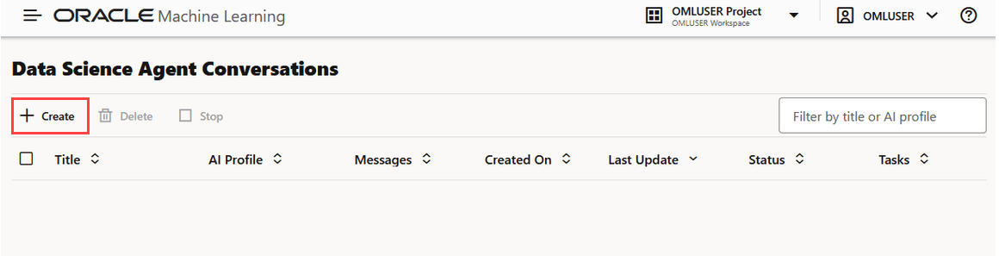
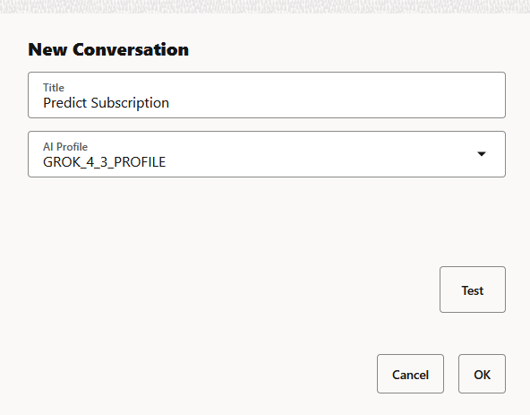
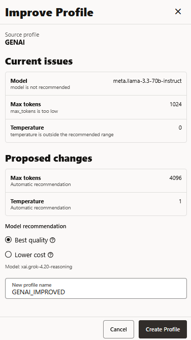
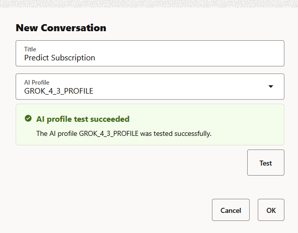
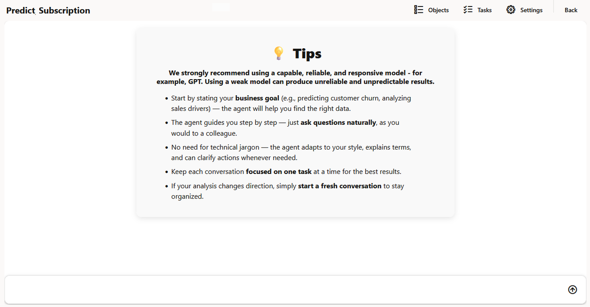

<!--
    {
        "name":"Create a Data Science Agent conversation",
        "description":"Steps to Create a Data Science Agent conversation"
    }
-->

To create a Data Science Agent conversation, you will open the Data Science Agent Conversations page and start the conversation creation workflow.

> **Note:** You can use the same Database user credentials to access the same conversation in multiple browsers. However, Oracle does not recommend this as it may lead to unexpected behavior. If you attempt this, Data Science Agent will display a warning, but you will have the option to override it.

To create a Data Science Agent conversation:

1. On the Oracle Machine Learning UI home page, click **Data Science Agent**. Alternatively, you can click the Cloud menu icon to open on the left navigation menu and click **Data Science Agent**. This opens the Data Science Conversations page.

2. On the **Data Science Agent Conversations** page, click **Create**.

    This action opens the **New Conversation** dialog, where you can define the conversation title and select the AI profile that Data Science Agent will use.

    

3. In the **New Conversation** dialog, define the following:

    

    * In the **Title** field, provide a name for your conversation. In this example, enter `Predict Subscription`.

    * In the **AI Profile** drop-down menu, click the down arrow and select `GROK_4_3_PROFILE`. Data Science Agent uses this AI profile to process prompts submitted in the conversation.

4. If the selected AI Profile has any issues, Data Science Agent displays a message showing the current issues along with the proposed changes.

    > **Note:** AI profiles may show warnings if the parameters `model`, `temperature`, or `max_tokens` are outside the recommended Data Science Agent ranges. However, a warning does not necessarily mean the profile cannot be selected.

    In the example below, Data Science Agent diagnosed issues related to model compatibility, tokens, and temperature settings associated with the AI profile `GENAI`.

    

    Data Science Agent also proposes the required changes, and recommends models based on best quality and lower costs. Scroll down to view the proposed changes. Select any model recommendation options here. You may also change the improved profile name suggested by the agent. Click **Create Profile**.

5. Click **Test** to validate the selected AI profile before creating the conversation. The profile test confirms that the selected profile can be used by Data Science Agent.

    

    > **Note:** Profile test failures can be caused by Access Control List (ACL), missing or deleted credentials, invalid credentials, invalid model, timeout, or unexpected `DBMS_CLOUD_AI.GENERATE` errors. To resolve errors, check ACL access, credential validity, model availability, and the request ID shown in the error.

6. Click **OK**. The conversation is created only if the selected profile test succeeds. After the conversation is created, Data Science Agent opens the chat interface.

## Task 2: Start Chatting with Data Science Agent

In this task, you will begin interacting with Data Science Agent by submitting a natural language prompt.

1. Review the tips displayed in the chat interface. Data Science Agent presents tips to help you begin the conversation and understand the types of prompts you can submit.

    

2. In the **Send a message** field, enter your prompt in natural language and press **Enter**.

    Use a natural language prompt to begin the interaction. Data Science Agent processes the prompt using the AI profile associated with the conversation.

