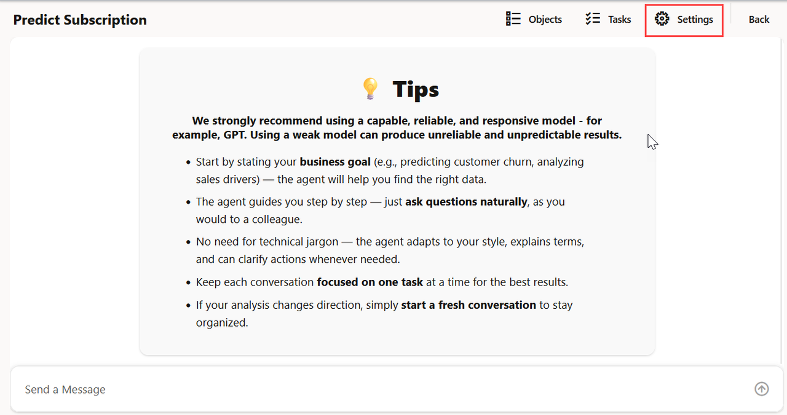
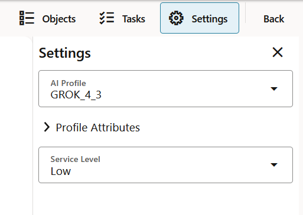
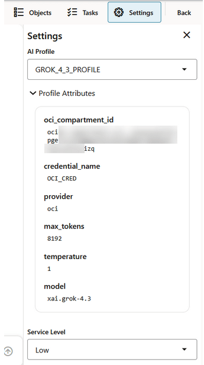

<!--
    {
        "name":"Manage AI Profile and Service Level of Data Science Conversation",
        "description":"Steps to Manage AI Profile and Service Level of Data Science Conversation"
    }
-->

In this task, you will learn how to change AI Profile and Database Service Levels of a conversation from the Settings option in the Data Science Conversation chat interface. 

> **Note:** These settings are conversation-specific.

To view and edit AI Profile and Database Service level:

1. On the Data Science Agent chat interface, click **Settings** on the top right corner of the page. This opens the Settings pane on the right.

    

2. On the Settings pane, you can manage the following:

    

    * Click **AI Profile** down arrow to select an AI profile for your conversation. 
    
        >**Note:** You can also change the profile in the middle of a conversation.
    * Click **Profile Attributes** down arrow to view the details of the selected AI profile.

        
    * Click **Service Level** down arrow to select a different database service level. By default, the service level is set to `Low`.

3. Click X to exit the Settings pane.
4. Click **Back** to go to the Data Science Agent Conversation listing page.

This completes the task of viewing and editing AI profile and database service level of the `Predict Subscription` conversation.

