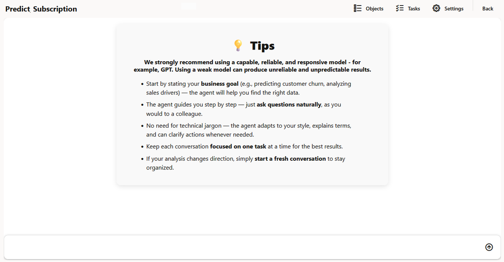

<!--
    {
        "name":"Start Chatting with Data Science Agent",
        "description":"Steps to chat with Data Science Agent"
    }
-->

In this task, you will begin interacting with Data Science Agent by submitting a natural language prompt.

1. Review the tips displayed in the chat interface. Data Science Agent presents tips to help you begin the conversation and understand the types of prompts you can submit.

    

2. In the **Send a message** field, enter your prompt in natural language and press **Enter**.

    Use a natural language prompt to begin the interaction. Data Science Agent processes the prompt using the AI profile associated with the conversation.

